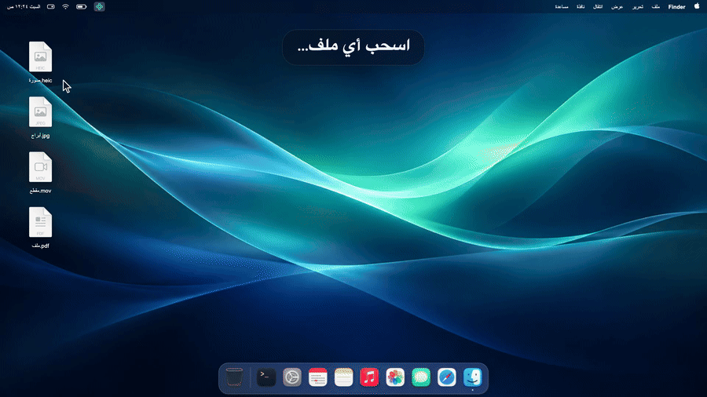

<p align="center"></p>

<h1 align="center">سحبة · Sahba</h1>

<p align="center">حوّل أي ملف وأنت تسحبه، على الماك<br>Convert any file while you drag it, on your Mac</p>

<p align="center"></p>

<div dir="rtl">

## التثبيت

افتح **الطرفية** (Terminal) والصق هالأمر:

</div>

```bash
curl -fsSL https://raw.githubusercontent.com/Khxxxxd/sahba/main/install.sh | bash
```

<div dir="rtl">

- يحتاج ماك بمعالج آبل (**M1 أو أحدث**) ونظام **macOS 14** أو أحدث.
- ما يحتاج Homebrew ولا Xcode. الأمر ينزّل سحبة و FFmpeg (للفيديو والصوت) ويتأكد من بصمتهم، وبعدها تطلع الأيقونة فوق في شريط القوائم.
- للتحديث: نفس الأمر مرة ثانية.

## الاستخدام

- اسحب أي ملف، ووأنت ساحبه اضغط **⇧ Shift**، فتطلع عجلة **التحويل**. افلت الملف على الصيغة اللي تبيها.
- والعجلة مفتوحة: **⌘ Command** للأدوات، و **⌃ Control** للإجراءات. آخر زر تضغطه هو اللي يحدد العجلة.
- الناتج ملف جديد جنب الأصلي، والأصلي ما ينلمس.
- كل شي يصير على جهازك، بدون نت.

| النوع | تحويل ⇧ | أدوات ⌘ |
|---|---|---|
| صور | PNG، JPG، HEIC، AVIF، TIFF، PDF | ضغط، قص، تدوير، حذف البيانات، دمج في PDF |
| فيديو | MP4، MOV، WebM، GIF، MP3، M4A | ضغط، قص، تدوير، حذف البيانات |
| صوت | MP3، M4A، WAV، FLAC، AIFF، OPUS | ضغط، قص، حذف البيانات |
| PDF | PNG، JPG، TXT، DOCX، RTF | ضغط، دمج، حذف البيانات |
| مستندات | DOCX، PDF، TXT، RTF، HTML، ODT | |

الإجراءات ⌃ لأي ملف أو مجلد: AirDrop، نسخ المسار، نقل، فتح في الطرفية، تعويم (نافذة صغيرة فوق كل النوافذ تحفظ الملفات لين تحتاجها).

- صور وفيديوهات الآيفون اللي فيها HDR تبقى HDR (ما عدا GIF و PNG و TIFF لأنها ما تدعمه).
- اللغة عربي أو English من قائمة الأيقونة.

## الحذف

</div>

```bash
curl -fsSL https://raw.githubusercontent.com/Khxxxxd/sahba/main/uninstall.sh | bash
```

---

## English

**Install** (Apple silicon Mac, M1 or later, macOS 14 or later):

```bash
curl -fsSL https://raw.githubusercontent.com/Khxxxxd/sahba/main/install.sh | bash
```

No Homebrew or Xcode needed. The installer downloads Sahba and FFmpeg (for video and audio), checks their
fingerprints, and opens Sahba: its icon appears in the menu bar. Run the same command again to update.

**Use:** drag any file and press **⇧ Shift** while dragging: a wheel of formats opens around the cursor. Drop the
file on the one you want; the result is saved next to the original. While the wheel is open, **⌘ Command** shows
tools (compress, crop, rotate, remove metadata, merge) and **⌃ Control** shows actions (AirDrop, copy path, move,
open in Terminal, float). Everything runs on your Mac, offline. iPhone HDR photos and videos stay HDR (except in
GIF, PNG and TIFF, which can't hold it). Arabic or English, from the menu-bar icon.

**Uninstall:**

```bash
curl -fsSL https://raw.githubusercontent.com/Khxxxxd/sahba/main/uninstall.sh | bash
```

**Troubleshooting:** `~/Applications/Sahba.app/Contents/MacOS/Sahba --doctor` prints the versions, chip and FFmpeg
it uses. Please include it when reporting a problem.

**Privacy:** Sahba has no network code and collects nothing. Only the installer goes online, to download
Sahba from this repository's releases and FFmpeg from [martin-riedl.de](https://ffmpeg.martin-riedl.de).

**Build from source:** `./build.sh` (needs Xcode command-line tools with the macOS 26 SDK).

Follow updates on X: [@khaled_cli](https://x.com/khaled_cli) · License: [MIT](LICENSE)

FFmpeg is a trademark of Fabrice Bellard. It is downloaded separately at install time and is licensed under the
GPL/LGPL; see [ffmpeg.org/legal.html](https://ffmpeg.org/legal.html).
